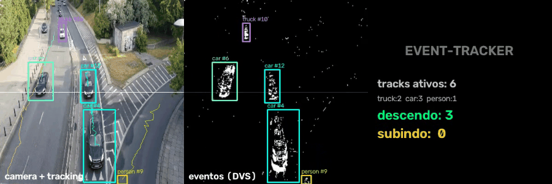

# SNN-Tracker (Event-Tracker)

Detecção, rastreamento e contagem de objetos **sem CNN** — usando apenas um stream de eventos de uma câmera neuromórfica simulada (DVS).



## A ideia

Câmeras de eventos só enxergam o que muda. Objetos em movimento aparecem como **clusters densos de eventos** — então a detecção vira um problema de clustering espacial, não de classificação de imagem. Este é um problema de pesquisa real (event-based tracking) implementado do zero:

```
video -> eventos ON/OFF (DVS simulado)
      -> dilatação + componentes conectados = bounding boxes
      -> matching por centroide + velocidade amortecida = tracks com ID
      -> cruzamento de linha com margem = contagem por direção
```

## Pipeline

| Etapa | Implementação |
|---|---|
| Eventos | Contraste temporal em log-intensidade, ref adaptativa (`src/events.py`) |
| Detecção | Dilatação morfológica + connected components (`src/detect.py`) |
| Tracking | Matching guloso por distância de centroide, velocidade amortecida, trilhas (`src/tracker.py`) |
| Contagem | Cruzamento de linha com margem anti-ruído (`src/demo.py`) |

## Uso

```bash
pip install -r requirements.txt
python -m src.demo raw/c02.mp4 -o demo/tracking.mp4
# converter p/ compartilhar:
ffmpeg -i demo/tracking.mp4 -c:v libx264 -pix_fmt yuv420p demo/tracking_h264.mp4
```

Saída: vídeo 3 painéis — câmera com boxes/IDs/trilhas | eventos DVS | estatísticas ao vivo.

## Por que isso importa

- **Sem rede neural**: detecção 100% geométrica — latência mínima, zero treino
- **Só movimento**: objetos parados custam zero computação
- Extensão natural: classificar cada track com a SNN do [snn-gesture](https://github.com/vsousadelvek/snn-gesture)

Terceiro projeto da série de computação neuromórfica, junto com [snn-ocr](https://github.com/vsousadelvek/snn-ocr).
